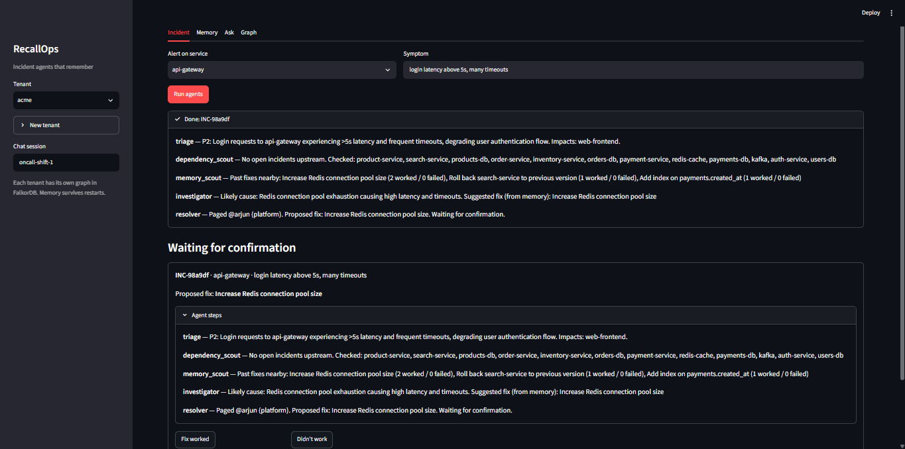
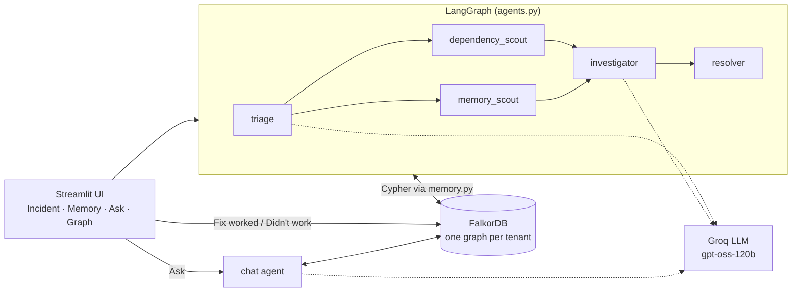
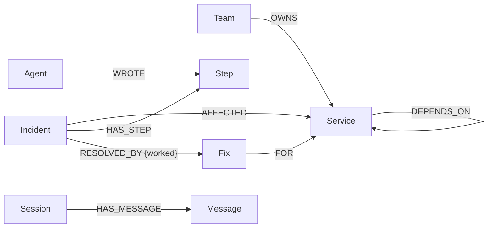
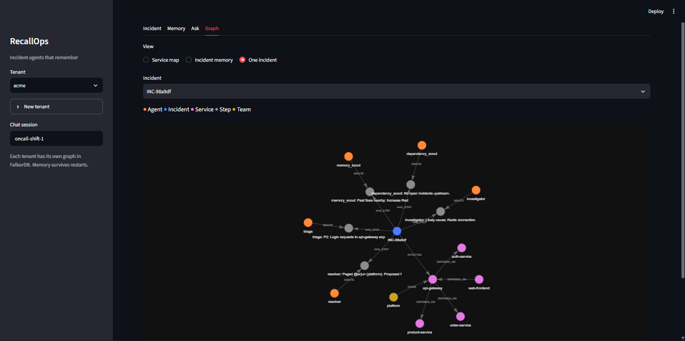

# RecallOps — incident agents that remember

> Five on-call agents share one memory in **FalkorDB**. They remember every incident, every step they took, and which fixes actually worked, so the next time something breaks they start from experience instead of from zero.

**Track 02: Agent Memory and Coordination** (primary) · also fits **Track 01: Agents That Act on Connected Data**
Built for WeMakeDevs × FalkorDB **Graph Hacks** (Oct 2026) by [Kuldeep Singh Naruka](https://github.com/Kuldeep-Singh-Naruka).

---

## The problem

When an alert fires at 3 AM, the on-call engineer asks the same questions every time: *what does this service depend on, who owns it, did we see this before, and what fixed it last time?* That knowledge lives in old Slack threads and people's heads. Most AI agents don't help, because they forget everything when the session ends.

## What RecallOps does

1. An alert comes in (service + symptom).
2. **triage** reads the service map from the graph, sets severity and who is impacted.
3. **dependency_scout** and **memory_scout** run **in parallel**. One checks for open incidents up to 3 hops upstream; the other recalls fixes from past incidents on this service *or anything it depends on*.
4. **investigator** waits for both, then picks the root cause and a fix. If a past fix fits, it takes it **from memory**, ranked by its track record.
5. **resolver** pages the owning team's on-call and waits for a human.
6. The human clicks **Fix worked** or **Didn't work**. That outcome is written back to the graph, so the fix's score goes up or down. On *Didn't work*, the agents immediately try the next-best fix (never the one that just failed) and escalate to humans after 3 failures.
7. An **Ask** chat answers questions from the same memory ("what usually fixes redis problems?"), and its history is stored in the graph too, so it survives restarts.

Every tenant (company) gets **its own graph**, so memories never leak between tenants.



---

## How it maps to Track 02

| Track 02 focus | Where it lives in RecallOps |
|---|---|
| **Semantic memory** | `Service`, `Team`, `OWNS`, `DEPENDS_ON`: the service map every agent reads |
| **Episodic memory** | `Incident` → `HAS_STEP` → `Step` ← `WROTE` ← `Agent`: what happened, in order, by whom |
| **Procedural memory** | `Fix` nodes with `success` / `fail` counters, linked by `RESOLVED_BY {worked}` and `FOR` a service |
| **Persistent conversation** | `Session` → `HAS_MESSAGE` → `Message`, reloaded after a restart |
| **Shared state & handoffs** | Agents pass work through the graph, not in-process: each one reads the steps the others wrote. Incident `status` moves through the pipeline |
| **High-concurrency writes** | Counters are updated inside one Cypher write (no read-modify-write in Python). Confirmations are exactly-once. Proven by `stress_test.py` |
| **Memory per tenant** | One FalkorDB graph per tenant: `recallops_acme`, `recallops_globex`, … |

---

## Architecture



- **LLM:** Groq `openai/gpt-oss-120b`, temperature 0, JSON-schema structured output. Only *triage*, *investigator* and the chat agent call the LLM. The scouts and the resolver are plain graph queries and code.
- **The LLM never writes to the graph directly.** It returns a past-fix *number* or a new fix, and the code writes the exact stored text, so counters accumulate on one `Fix` node instead of near-duplicate paraphrases.
- **Rules are enforced in code, not just in the prompt:** a fix with zero wins is never taken from memory, a fix that already failed on this incident is never offered again, and incidents escalate after 3 failed fixes.

### Incident lifecycle

```
open → triage → scouts → investigator → resolver → awaiting_confirmation
     → resolved                                   (Fix worked)
     → retrying → investigator → resolver → awaiting_confirmation …   (Didn't work)
     → escalated                                  (after 3 failed fixes)
```

---

## Graph data model



| Node | Key properties |
|---|---|
| `Service` | `name` |
| `Team` | `name`, `oncall` |
| `Incident` | `id`, `symptom`, `status`, `proposed_fix`, `created_at` |
| `Step` | `agent`, `text`, `ts` |
| `Agent` | `name` |
| `Fix` | `id` (normalised slug), `text`, `success`, `fail` |
| `Session` / `Message` | `id` / `role`, `text`, `ts` |

Indexes: `Service.name`, `Team.name`, `Incident.id`, `Fix.id`, `Session.id`.

Two seed architectures: **ecommerce** (14 services, 6 teams, 6 past incidents incl. one failed fix) and **streaming** (11 services, 4 teams, empty memory), so a new tenant really looks different.



---

## Cypher queries

All queries live in [`memory.py`](memory.py) and are parameterised (no string building).

**Recall fixes from this service and anything it depends on (multi-hop), best track record first**
```cypher
MATCH (:Service {name: $svc})-[:DEPENDS_ON*0..3]->(d:Service)
      <-[:AFFECTED]-(i:Incident)-[:RESOLVED_BY]->(f:Fix)
RETURN f.text AS fix, f.success AS success, f.fail AS fail,
       collect(DISTINCT d.name) AS services,
       collect(DISTINCT i.symptom) AS symptoms
ORDER BY success - fail DESC
LIMIT 5
```

**Confirm a fix: exactly-once, atomic counters**
```cypher
MATCH (i:Incident {id: $id})-[:AFFECTED]->(s:Service)
WHERE i.status = 'awaiting_confirmation'
MERGE (f:Fix {id: $fix_id})
  ON CREATE SET f.text = $fix, f.success = 0, f.fail = 0
MERGE (f)-[:FOR]->(s)
CREATE (i)-[:RESOLVED_BY {worked: $worked}]->(f)
SET i.status = CASE WHEN $worked THEN 'resolved' ELSE 'retrying' END,
    f.success = f.success + CASE WHEN $worked THEN 1 ELSE 0 END,
    f.fail    = f.fail    + CASE WHEN $worked THEN 0 ELSE 1 END
RETURN count(i)
```
The `WHERE status` guard and the `SET` run in the same write, so if two engineers click at the same moment, only one counts.

**Agent handoff: write a step to the shared incident**
```cypher
MATCH (i:Incident {id: $id})
MERGE (a:Agent {name: $agent})
CREATE (st:Step {agent: $agent, text: $text, ts: $ts})
CREATE (i)-[:HAS_STEP]->(st)
CREATE (a)-[:WROTE]->(st)
SET i.status = $agent
```

**Dependency scout: open incidents up to 3 hops upstream in the last 2 hours**
```cypher
MATCH (:Service {name: $svc})-[:DEPENDS_ON*1..3]->(d:Service)<-[:AFFECTED]-(i:Incident)
WHERE i.status <> 'resolved' AND i.created_at > $since
RETURN DISTINCT d.name AS service, i.id AS incident, i.symptom AS symptom
```

**Blast radius: who breaks if this service is down**
```cypher
MATCH (u:Service)-[:DEPENDS_ON*1..3]->(:Service {name: $svc})
RETURN DISTINCT u.name
```

**Fixes already tried on this incident (so a retry never repeats them)**
```cypher
MATCH (:Incident {id: $id})-[:RESOLVED_BY {worked: false}]->(f:Fix)
RETURN f.text
```

**Persistent chat history**
```cypher
MERGE (s:Session {id: $sid})
CREATE (m:Message {role: $role, text: $text, ts: $ts})
CREATE (s)-[:HAS_MESSAGE]->(m)
```
```cypher
MATCH (:Session {id: $sid})-[:HAS_MESSAGE]->(m:Message)
RETURN m.role AS role, m.text AS text
ORDER BY m.ts DESC, id(m) DESC
LIMIT $limit
```

**Seeding the service map (idempotent)**
```cypher
UNWIND $rows AS row
MERGE (t:Team {name: row.team})
SET t.oncall = row.oncall
MERGE (s:Service {name: row.service})
MERGE (t)-[:OWNS]->(s)
```

---

## Concurrency: proven, not claimed

`stress_test.py` throws 50 threads at the same `Fix` node:

```
50 workers writing to the same Fix node at the same time:

naive (read, +1, write)      expected +50   got +2    LOST UPDATES  (0.04s)
RecallOps resolve_incident   expected +49   got +49   OK  (0.04s)
parallel add_step            expected +50   got +50   OK
same incident, N confirms    expected +1    got +1    OK
```

- **naive** is the common mistake: read the counter in Python, add 1, write it back. 48 of 50 updates vanish.
- **resolve_incident** does the increment inside one Cypher write, so nothing is lost.
- **parallel add_step**: 50 agents append steps to one incident and none go missing.
- **same incident, N confirms**: 50 people confirm the same incident at once and it counts once.

It also passes with `python stress_test.py 200`.

## Tests

`tests.py` runs 35 checks with a fake LLM (no API key needed) on throwaway tenants that it deletes afterwards:

```
PASS seed is idempotent (re-run adds nothing)
PASS recall for auth-service ranks pool fix first
PASS fix taken verbatim from memory
PASS re-confirming a resolved incident is ignored
PASS 10 concurrent confirms of ONE incident count once
PASS Didn't work -> agents propose a DIFFERENT fix
PASS 3 failed fixes -> escalated, no endless loop
PASS code refuses a never-worked fix even if LLM picks it
PASS dependency scout links open upstream redis incident
PASS chat session isolated per tenant
PASS Cypher-looking symptom stored as plain data
...
35/35 passed
```

---

## Run it locally

**Needs:** Python 3.12+, Docker, a free [Groq API key](https://console.groq.com/keys).

```bash
git clone https://github.com/Kuldeep-Singh-Naruka/recallops.git
cd recallops

# 1. FalkorDB (DB on 6379, FalkorDB Browser on http://localhost:3000)
docker compose up -d

# 2. Python env
python -m venv .venv
source .venv/bin/activate          # Windows: .venv\Scripts\activate
pip install -r requirements.txt

# 3. Config
cp .env.example .env               # Windows: copy .env.example .env
#   then put your GROQ_API_KEY in .env

# 4. Seed the demo tenant "acme" (service map + 6 past incidents)
python seed.py

# 5. Run
streamlit run app.py
```

Optional checks:
```bash
python tests.py          # 35 checks, no LLM calls
python stress_test.py    # concurrency proof (add a number for more workers)
python agents.py         # one incident end-to-end in the terminal
```

### Try this
1. Tenant **acme** → service **auth-service** → symptom *login latency above 5s, many timeouts* → **Run agents**. The investigator suggests a fix **(from memory)**.
2. Click **Didn't work**. The agents save the failure and propose a different fix.
3. Click **Fix worked**. Open **Memory** and the fix's count went up.
4. **Ask**: *"What usually fixes redis problems?"* Then restart the app: the chat is still there.
5. Sidebar → **New tenant** `globex` (streaming). Its own service map, empty memory.
6. **Graph** → *One incident* to see the agents, their steps and the fix as a graph.

| Env var | Default | |
|---|---|---|
| `GROQ_API_KEY` | – | required |
| `GROQ_MODEL` | `openai/gpt-oss-120b` | |
| `FALKORDB_HOST` / `FALKORDB_PORT` | `localhost` / `6379` | |
| `FALKORDB_USERNAME` / `FALKORDB_PASSWORD` | empty | for FalkorDB Cloud |

## Project layout

| File | What it does |
|---|---|
| `db.py` | FalkorDB connection, one graph per tenant, indexes |
| `memory.py` | Every Cypher query: semantic, episodic, procedural, chat |
| `agents.py` | LangGraph pipeline, retry graph, chat agent |
| `app.py` | Streamlit UI |
| `seed.py` | Two architecture templates + past incidents |
| `stress_test.py` | Concurrency proof |
| `tests.py` | 35 automated checks |

## Limitations & next steps

- Fix recall matches by service and dependency path. Adding vector similarity on symptoms (FalkorDB supports vector indexes) would also catch "same symptom, different service".
- Paging and fixes are simulated. Next: real PagerDuty / Slack / runbook actions.
- Expose the memory as MCP tools so other agents (Claude, Cursor) can use the same incident memory.

---

## AI usage disclosure

This project was built with **Claude (Anthropic)** as a coding assistant, as the hackathon rules allow. Claude helped write and review the code, wrote the test cases (`tests.py`, `stress_test.py`) and helped draft this README. I chose the idea, the graph model and the trade-offs, ran and checked every step, and committed the work myself. I can explain any line of it.

At runtime the agents use **Groq `openai/gpt-oss-120b`**. All data is synthetic.

## License

[MIT](LICENSE)
